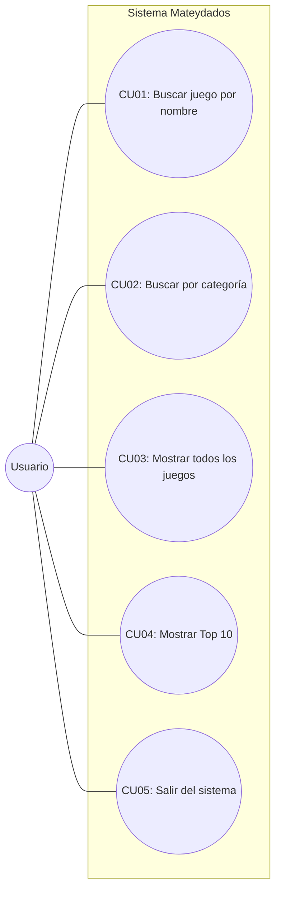

# Matesydados

## Diagrama de Casos de Uso

---

### CU 1: Buscar juego por nombre
* **Actor:** Usuario
* **Precondición:** El catálogo de juegos (`datos/juegos_500.json`) fue cargado en el Árbol AVL (`_arbol_nombre`) al iniciar la aplicación.
* **Flujo Principal:**
  1. El usuario selecciona la opción `1` ("Buscar juego por nombre") en el menú de la terminal.
  2. El sistema solicita ingresar el nombre del juego de mesa.
  3. El usuario ingresa el nombre (ej. "Catan").
  4. El sistema consulta en la clase `Catalogo`, delegando la búsqueda al árbol AVL (sin distinguir mayúsculas ni minúsculas).
  5. El sistema muestra en pantalla la ficha técnica detallada del juego utilizando el método `__repr__` de la clase `Juego`.
* **Flujo Alternativo:**
  * **A1 (Texto vacío):** Si el usuario presiona ENTER sin escribir nada, el sistema informa *"No ha ingresado ningún nombre"* y regresa al menú.
  * **A2 (Juego inexistente):** Si el juego no se encuentra en el árbol, el sistema informa *"No se encontró el juego 'nombre'"*.

---

### CU 2: Buscar por categoría
* **Actor:** Usuario
* **Precondición:** El catálogo está cargado y el árbol general de categorías está disponible.
* **Flujo Principal:**
  1. El usuario selecciona la opción `2` ("Buscar por categoría") en la terminal.
  2. El sistema muestra los grupos de categorías.
  3. El usuario selecciona un grupo por número.
  4. El sistema muestra las categorías de ese grupo.
  5. El usuario selecciona una categoría por número.
  6. El catálogo filtra los juegos de esa categoría.
  7. El sistema muestra los juegos encontrados.
* **Flujo Alternativo:**
  * **A1 (Volver):** Si el usuario selecciona `0` en la lista de grupos o categorías, vuelve al menú.
  * **A2 (Opción inválida):** El sistema informa que la selección no es válida.
  * **A3 (Sin resultados):** El sistema informa que no hay juegos en la categoría elegida..

---

### CU 3: Mostrar todos los juegos
* **Actor:** Usuario
* **Precondición:** El catálogo de juegos está cargado en memoria.
* **Flujo Principal:**
  1. El usuario selecciona la opción `3` ("Mostrar todos los juegos") en el menú principal.
  2. El sistema invoca al método `mostrar_todos()` de la clase `Catalogo`.
  3. El sistema imprime en la consola la ficha completa de cada uno de los juegos cargados en el dataset.
* **Flujo Alternativo:**
  * **A1 (Catálogo vacío):** Si el catálogo se encuentra vacío, el sistema indica *"No hay juegos cargados"*.

---

### CU 4: Mostrar Top 10
* **Actor:** Usuario
* **Precondición:** El catálogo de juegos está cargado y el heap contiene los juegos disponibles.
* **Flujo Principal:**
  1. El usuario selecciona la opción `4` ("Mostrar ranking TOP 10") en el menú de la terminal.
  2. El sistema consulta el método `obtener_top(10)` de la clase `Catalogo`.
  3. El catálogo obtiene los juegos de mayor prioridad extrayéndolos de una copia del heap.
  4. El sistema muestra hasta 10 juegos ordenados por rating descendente; en caso de empate, por nombre alfabético.
* **Flujo Alternativo:**
  * **A1 (Catálogo vacío):** Si no hay juegos disponibles, el sistema informa *"No hay juegos cargados"*.
  * **A2 (Menos de 10 juegos):** Si hay menos de 10 juegos, el sistema muestra todos los disponibles.

---

### CU 5: Salir del sistema
* **Actor:** Usuario
* **Flujo Principal:**
  1. El usuario selecciona la opción `4` ("Salir").
  2. El sistema muestra un mensaje de despedida (*"Gracias por visitarnos! Hasta luego."*) y finaliza el bucle de ejecución.

